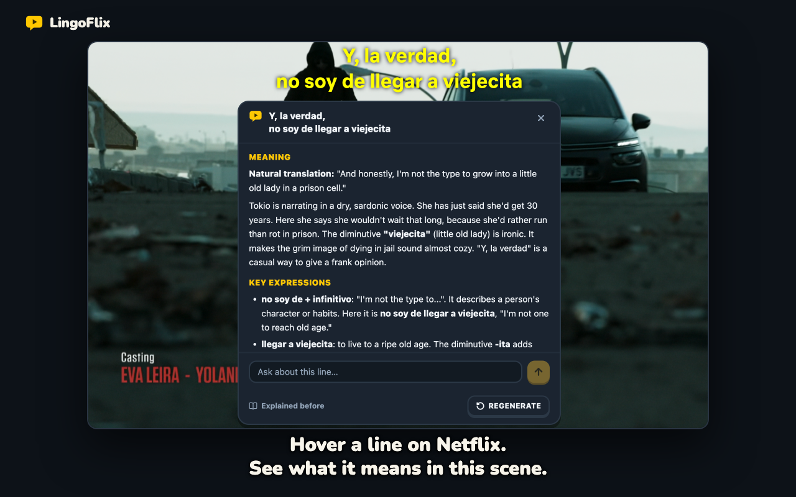
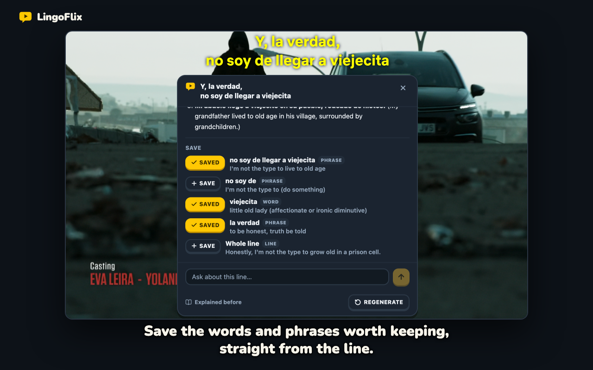
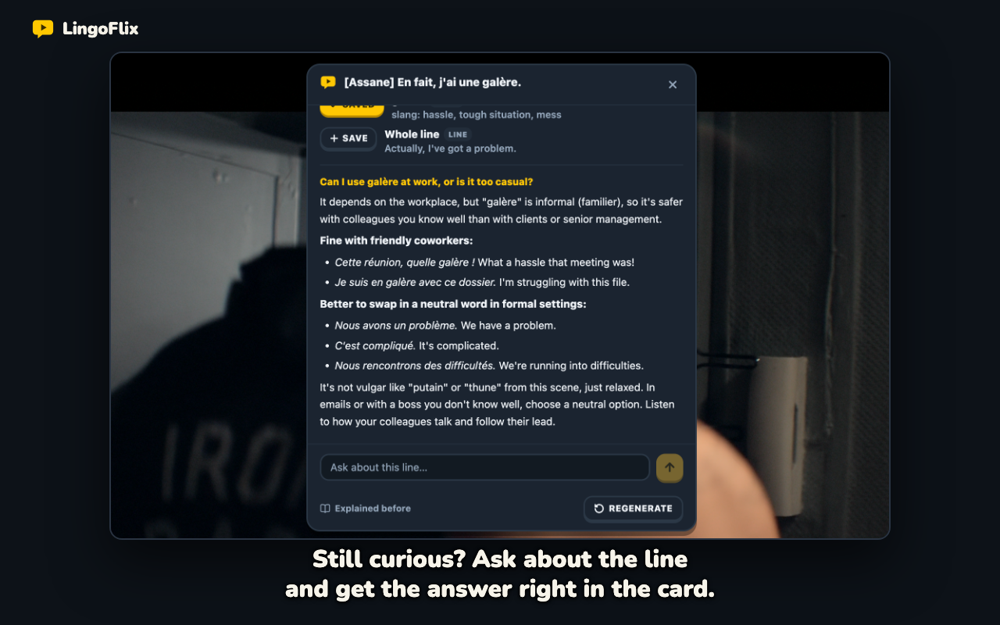
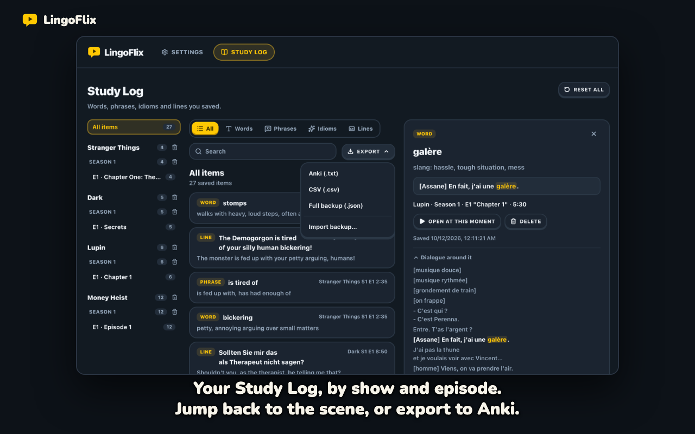
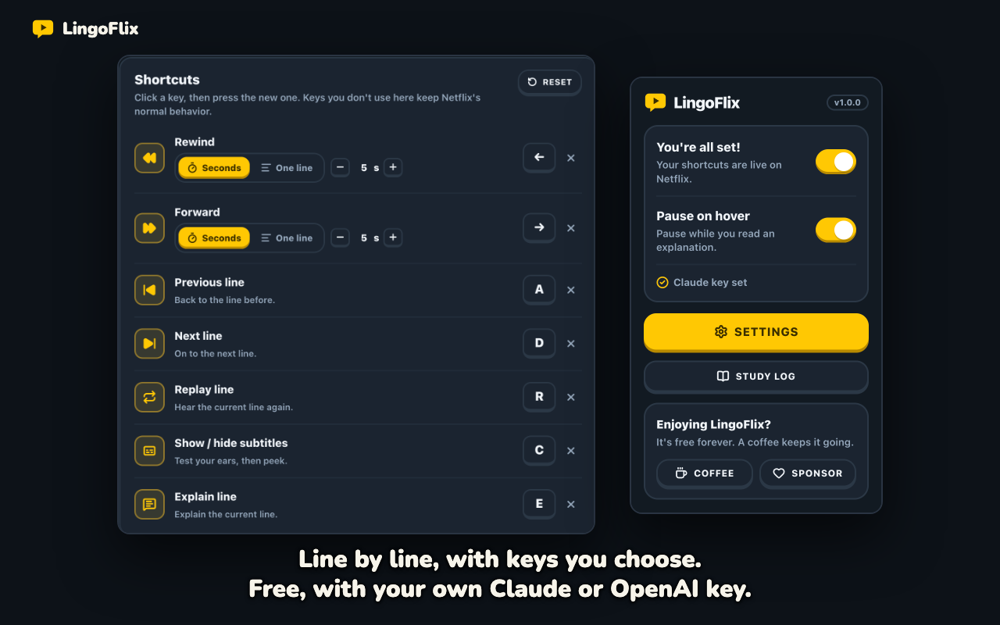

<div align="center">


# LingoFlix

**Understand every line on Netflix.**

A free, open-source Chrome extension for learning a language with the shows you already watch.
Hover a subtitle and get what it means in this scene, save the words worth keeping, and move through the dialogue line by line.

[](./LICENSE)
[](./lingoflix-extension)
[](https://github.com/sponsors/jaycho1214)
[](https://buymeacoffee.com/jaycho1214)



</div>

## What it does

**Explain any line.** Hover a subtitle (or press <kbd>E</kbd>) and Claude or OpenAI explains what it means in this
scene, the key expressions, and how to use them, using the surrounding dialogue. Ask follow-up questions right in the
card. An answer keeps going if you close the card, and a line you explained before opens instantly, at no cost.

**Study Log.** Each explanation suggests the words, phrases, idioms and lines worth keeping; save the ones you want.
Browse them by show, season and episode, filter and search them, open any one to see the scene and the explanation,
jump back to that moment on Netflix, and export to Anki or CSV (or a full backup you can import again).

**Line by line.** Jump to the previous or next line, replay the current one, or make ← / → move by line instead of
seconds. Pick how many seconds rewind and forward skip, hide subtitles with one key, and remap every shortcut.

**Study reminders.** Pick the days and a time, and LingoFlix reminds you to study with Netflix. It skips the days
you've already watched with LingoFlix on. Off until you turn it on.

<table>
  <tr>
    <td></td>
    <td></td>
  </tr>
  <tr>
    <td></td>
    <td></td>
  </tr>
</table>

## Keyboard shortcuts

On a Netflix watch page, with LingoFlix on. Every one can be changed in Settings.

| Key | What it does |
|---|---|
| <kbd>E</kbd> | Explain the current line |
| <kbd>A</kbd> / <kbd>D</kbd> | Previous / next line |
| <kbd>R</kbd> | Replay the current line |
| <kbd>C</kbd> | Show or hide subtitles |
| <kbd>←</kbd> / <kbd>→</kbd> | Rewind / forward 5 seconds, or one line if you choose |

## Your key, your data

LingoFlix uses your own API key from Anthropic (Claude) or OpenAI: get one at
[console.anthropic.com](https://console.anthropic.com/settings/keys) or
[platform.openai.com](https://platform.openai.com/api-keys), and you pay that company directly for what you use.
LingoFlix tells which one it is from the key.

The key and your Study Log stay on your computer. Only when you ask for an explanation or a follow-up does LingoFlix
send the line, the show and episode it's from, the dialogue around it, the episode's earlier subtitle lines (you can
turn this off in Settings), and a list of your recent saved items and explained lines (with the show and episode each
is from), so the AI can build on it. They go straight from your browser to Anthropic or OpenAI, whichever your key is
from, with your key, never through a LingoFlix server. Requests to OpenAI ask it not to store them.

While study reminders are on, LingoFlix keeps the date you last watched with it and the name of that show on your
computer, to skip days you've watched and to offer the show. It never leaves your computer, and turning reminders off
deletes it.

Read the full [privacy policy](https://lingoflix.lipsum.fun/privacy).

## Install

LingoFlix is on its way to the Chrome Web Store. Until it's listed, load it from source:

1. `pnpm install`, then `pnpm build` (see [Development](#development)).
2. Open `chrome://extensions`, turn on **Developer mode**, click **Load unpacked**, and pick
   `lingoflix-extension/.output/chrome-mv3`.
3. Open LingoFlix's Settings from its toolbar icon and paste your Claude or OpenAI key.

## Development

```bash
pnpm install     # installs every package in the workspace
pnpm test        # unit tests
pnpm compile     # type-check
pnpm build       # production builds (extension → lingoflix-extension/.output/chrome-mv3, server → lingoflix-server/.next)
```

| Folder | What it is |
|---|---|
| [`lingoflix-extension/`](./lingoflix-extension) | The Chrome extension (WXT, React, TypeScript) |
| [`lingoflix-server/`](./lingoflix-server) | The website (Next.js): the landing page, the install and uninstall pages, privacy and terms |
| [`docs/`](./docs) | Design specs, implementation plans, and the [Chrome Web Store listing](./docs/store/chrome-web-store.md) |

See [`lingoflix-extension/README.md`](./lingoflix-extension/README.md) for trying the extension on Netflix, and
[`lingoflix-server/README.md`](./lingoflix-server/README.md) for running the website locally.

## Support

LingoFlix is free. If it helps you learn, you can support it:

<a href="https://buymeacoffee.com/jaycho1214"></a>
&nbsp;
<a href="https://github.com/sponsors/jaycho1214"></a>

## License

[MIT](./LICENSE). Not affiliated with or endorsed by Netflix, Anthropic or OpenAI.
